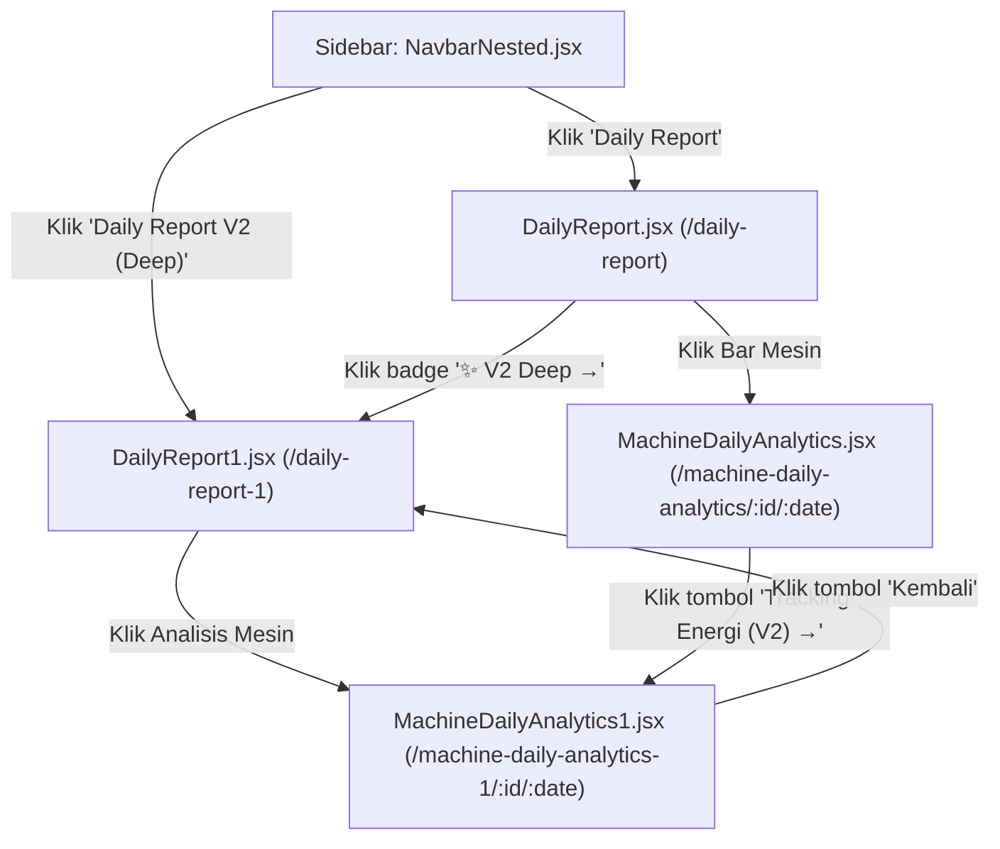

# Analisis Mendalam: File Duplikat, File Varian (*1, *2, _copy), dan Pemetaan Routing

Dokumen ini membedah seluruh file yang berindikasi **duplikat, varian versi (`*1`, `*v2`), salinan cadangan (`_copy`), serta file artefak lama** di dalam repositori **Plant-Monitor**.

> [!IMPORTANT]
> **Prinsip Utama Evaluasi:**  
> **Tidak ada file yang langsung dihapus.** Setiap file dianalisis berdasarkan:
> 1. Apakah file tersebut di-import atau memiliki rute aktif?
> 2. Ke mana alur navigasinya (*routing map*)?
> 3. Apa perbedaan fungsionalnya dengan file "kembarannya"?
> 4. Status: **Aktif Terpakai**, **File Varian Fitur (Bukan Sampah)**, atau **Benar-benar Tidak Terpakai (Dead Code)**.

---

## 1. Matriks Rangkuman Status File

| No | File / Pasangan File | Lokasi | Status Saat Ini | Alur Routing / Referensi Pemanggil | Rekomendasi Solusi Tanpa Hapus Terburu-buru |
| :--- | :--- | :--- | :---: | :--- | :--- |
| **1** | `DailyReport1.jsx` (vs `DailyReport.jsx`) | `frontend/src/pages/` | **AKTIF TERPAKAI** | Rute `/daily-report-1`, Sidebar *NavbarNested* ("Daily Report V2"), Tombol pill di `DailyReport.jsx` | Jangan dihapus. Ini adalah fitur "Deep Analytics". Cukup *rename* menjadi `DailyReportDeep.jsx`. |
| **2** | `MachineDailyAnalytics1.jsx` (vs `MachineDailyAnalytics.jsx`) | `frontend/src/pages/` | **AKTIF TERPAKAI** | Rute `/machine-daily-analytics-1/:machineId/:date`, Tombol "Tracking Energi (V2)" di `MachineDailyAnalytics.jsx` | Jangan dihapus. Ini adalah dossier 60-batch & tracking energi uap/listrik. *Rename* ke `MachineDailyDeepAnalytics.jsx`. |
| **3** | `machine_admin_copy.js` | `monitoring/static/admin/js/` | **KRITIS: AKTIF TERPAKAI** | Template Django Admin: `machine/change_list.html` baris 6 | **Dilarang keras dihapus!** Ini satu-satunya script JS admin mesin. Cukup rename ke `machine_admin.js` dan update templatenya. |
| **4** | `models_production_reports.py` & `admin_production_reports.py` | `monitoring/` | **AKTIF TERPAKAI** | Di-import langsung oleh `models.py` (L3261) & `admin.py` (L4143) | **Bukan duplikat!** Ini adalah hasil modularisasi resmi sub-domain laporan produksi. Pertahankan. |
| **5** | `bootstrap_anomalies_v2.py` | `monitoring/management/commands/` | **AKTIF TERPAKAI** | Management Command Django `python manage.py bootstrap_anomalies_v2` | **Bukan duplikat** (file v1 sudah tidak ada). Tetap gunakan sebagai skrip inisialisasi threshold anomali. |
| **6** | `requirements_clean.txt` & `requirements_fixed.txt` | Root | **CLEAN: TERPAKAI DI DOCKERFILE**<br>**FIXED: TIDAK TERPAKAI** | `Dockerfile` baris 16 & 19 memanggil `requirements_clean.txt`. `requirements_fixed.txt` tidak ada yang memanggil. | Samakan isinya ke `requirements.txt`, arahkan `Dockerfile` ke `requirements.txt`, lalu arsipkan varian lainnya. |
| **7** | `dist_blue` & `dist_green` | `frontend/` | **TERPAKAI SISTEM OPERASIONAL** | Skrip deployment `deploy.ps1` (Blue-Green slot switcher) | Bukan kode sumber. Jangan di-commit ke Git (masukkan `.gitignore`), tetapi jangan dihapus jika ingin Blue-Green jalan di server. |
| **8** | 15 File `.cjs`, `mock.cjs`, `out.cjs`, `render-test.jsx` | Root `frontend/` | **100% TIDAK TERPAKAI (DEAD CODE)** | Tidak di-import di `src/`, tidak ada di `package.json` | Skrip patch AST/regex sekali pakai di masa lalu. Karantina ke `scripts/frontend_codemods/`. |
| **9** | `old_daily_report.txt`, `old_daily_report_2.txt`, `old_api_report.txt` | Root | **100% TIDAK TERPAKAI** | File teks dump riwayat chat/debugging AI (September 2026) | Karantina ke `archive/legacy_debug/`. |

---

## 2. Bedah Detail: Pasangan File Frontend yang Sering Disalahpahami

### Kasus A: `DailyReport.jsx` vs `DailyReport1.jsx`

Banyak yang mengira `DailyReport1.jsx` adalah file sampah hasil "copy-paste lalu lupa dihapus". Hasil pelacakan kode membuktikan **asumsi tersebut salah**:



#### Analisis Alur Routing & Navigasi:
1. **Di `frontend/src/App.jsx`:**
   ```jsx
   // Baris 54 & 111-112:
   const DailyReport = lazyWithRetry(() => import('./pages/DailyReport'), 'DailyReport');
   const DailyReport1 = lazyWithRetry(() => import('./pages/DailyReport1'), 'DailyReport1');

   { path: '/daily-report', element: <DailyReport />, pageCode: 'daily_report' },
   { path: '/daily-report-1', element: <DailyReport1 />, pageCode: 'daily_report' },
   ```
2. **Di `frontend/src/components/sidebar/NavbarNested.jsx`:**
   ```javascript
   // Baris 43-44:
   { label: 'Daily Report', path: '/daily-report', icon: FileText, pageCode: 'daily_report' },
   { label: 'Daily Report V2 (Deep)', path: '/daily-report-1', icon: Compass, pageCode: 'daily_report' },
   ```
3. **Cross-Link di Dalam Komponen:**
   * Di `DailyReport.jsx` baris 803–809, terdapat tombol navigasi khusus:
     ```jsx
     <a href="/daily-report-1" className="..." title="Buka Laman Eksperimen Analisis Mendalam">
       ✨ V2 Deep &rarr;
     </a>
     ```

#### Perbedaan Fungsional:
* **`DailyReport.jsx` (Klasik / Overview Ringkas):**
  * Menampilkan ringkasan ketersediaan mesin secara visual mendatar (*Availability Bar*), chart boiler ringkas, dan modal breakdown kerugian (*LossesBreakdownModal*).
* **`DailyReport1.jsx` (Eksperimen Analisis Mendalam / Deep View):**
  * Menambahkan indikator tren naik/turun (*TrendingUp / TrendingDown*), skor utilitas boiler yang lebih detail, dan mengarahkan klik detail mesin ke `MachineDailyAnalytics1`.

> [!TIP]
> **Rekomendasi Arsitektur:**  
> Jangan dihapus! Ganti nama file dan rutenya agar tidak terkesan "file copy":
> * Rename file: `DailyReport1.jsx` ➔ `DailyReportDeep.jsx`
> * Ubah rute di `App.jsx`: `/daily-report-1` ➔ `/daily-report/deep` (tambahkan redirect dari `/daily-report-1` agar bookmark lama tidak rusak).

---

### Kasus B: `MachineDailyAnalytics.jsx` vs `MachineDailyAnalytics1.jsx`

Sama seperti kasus di atas, kedua file ini saling terhubung secara fungsional:

#### Analisis Alur Routing & Endpoint API:
1. **Di `frontend/src/App.jsx`:**
   ```jsx
   // Baris 61-62 & 114-115:
   const MachineDailyAnalytics = lazyWithRetry(() => import('./pages/MachineDailyAnalytics'), 'MachineDailyAnalytics');
   const MachineDailyAnalytics1 = lazyWithRetry(() => import('./pages/MachineDailyAnalytics1'), 'MachineDailyAnalytics1');

   { path: '/machine-daily-analytics/:machineId/:date', element: <MachineDailyAnalytics />, pageCode: 'daily_report' },
   { path: '/machine-daily-analytics-1/:machineId/:date', element: <MachineDailyAnalytics1 />, pageCode: 'daily_report' },
   ```
2. **Endpoint Backend yang Dipanggil:**
   * `MachineDailyAnalytics.jsx`: Memanggil `GET /report/machine/${machineId}/daily-chart?date=${date}` (Menampilkan timeline proses, kurva temperatur, dan profil tekanan standar).
   * `MachineDailyAnalytics1.jsx`: Memanggil `GET /report/machine/${machineId}/daily-chart-deep?date=${date}` (Perhatikan ada akhiran **`-deep`**!). Endpoint backend ini mengembalikan data konsumsi uap per batch, rasio listrik LWBP/WBP, serta scatter plot 60-batch efisiensi termal.
3. **Cross-Link:**
   * Di dalam `MachineDailyAnalytics.jsx` baris 277–285, terdapat tombol switcher:
     ```jsx
     <button onClick={() => navigate(`/machine-daily-analytics-1/${machineId}/${date}`)}>
       <Zap size={14} /> Tracking Energi (V2) &rarr;
     </button>
     ```
   * Di dalam `MachineDailyAnalytics1.jsx` baris 182, tombol kembali diarahkan ke `/daily-report-1`.

> [!TIP]
> **Rekomendasi Arsitektur:**  
> Keduanya aktif dan melayani kebutuhan yang berbeda. 
> * Rename file: `MachineDailyAnalytics1.jsx` ➔ `MachineDailyEnergyDossier.jsx`
> * Ubah rute: `/machine-daily-analytics/:machineId/:date/energy`

---

## 3. Bedah Kasus Berbahaya: `machine_admin_copy.js`

Di folder `monitoring/static/admin/js/`, terdapat file bernama `machine_admin_copy.js` (7.266 bytes).

* **Apakah ada file asli bernama `machine_admin.js`?**  
  **TIDAK ADA.** File `machine_admin.js` tidak ditemukan di direktori tersebut.
* **Apakah file ini dipakai?**  
  **SANGAT DIPAKAI.** Di dalam template Django Admin `monitoring/templates/admin/monitoring/machine/change_list.html` baris 6:
  ```html
  <script src="" defer></script>
  ```

> [!CAUTION]
> **Peringatan Kritis:**  
> Jika seorang developer menghapus file ini hanya karena melihat kata `_copy`, maka **halaman Admin Mesin Django akan langsung rusak (JavaScript error / 404 static file)**.  
> **Langkah yang benar:**  
> 1. Buat salinan atau rename file menjadi `machine_admin.js`.  
> 2. Perbarui baris template HTML menjadi `<script src="" defer></script>`.  
> 3. Baru setelah itu hapus nama lama `machine_admin_copy.js`.

---

## 4. Bedah Kasus Dependensi: `requirements.txt` vs `requirements_clean.txt` vs `requirements_fixed.txt`

Terdapat 3 variasi file requirements di root direktori. Berikut hasil auditnya:

1. **`requirements.txt` (613 bytes):**
   * Berisi dependensi lengkap untuk local development: `django-ninja==1.3.0`, `django-cors-headers==4.6.0`, `django-admin-rangefilter==0.13.5`, `scipy`, `numpy`, dll.
2. **`requirements_clean.txt` (589 bytes):**
   * **AKTIF DIPAKAI OLEH DOCKER.** Di dalam `Dockerfile` baris 16 & 19:
     ```dockerfile
     COPY requirements_clean.txt .
     RUN pip install --no-cache-dir -r requirements_clean.txt gunicorn redis django-redis
     ```
   * **Masalah:** File ini belum menyertakan `django-ninja` dan `django-cors-headers` secara eksplisit di dalamnya (hanya terinstall jika ditimpa manual).
3. **`requirements_fixed.txt` (690 bytes):**
   * **TIDAK TERPAKAI.** Tidak ada skrip Docker, bash, atau powershell yang merujuk ke file ini.

> [!TIP]
> **Rekomendasi Solusi:**  
> 1. Sinkronkan `requirements.txt` menjadi sumber kebenaran tunggal (*Single Source of Truth*).
> 2. Ubah `Dockerfile` agar menggunakan `COPY requirements.txt .` dan `RUN pip install -r requirements.txt ...`.
> 3. Pindahkan `requirements_clean.txt` dan `requirements_fixed.txt` ke folder `archive/` agar root repositori bersih.

---

## 5. File yang 100% Tidak Terpakai (Aman untuk Dikarantina)

File-file berikut telah diperiksa di seluruh kode sumber frontend dan backend, dan **tidak memiliki referensi atau fungsi operasional aktif**:

### A. Skrip Patch di Root Frontend (`frontend/*.cjs` & `frontend/render-test.jsx`)
* `apply_segmented.cjs`, `apply_segmented2.cjs`, `apply_tablet_merge.cjs`
* `check_table.cjs`, `dynamic_groups.cjs`, `fetch_status.cjs`
* `fix.cjs`, `fix.js`, `fix_machine_code.cjs`, `fix_messy.cjs`, `fix_messy2.cjs`, `fix_render_groups.cjs`, `fix_sectioncard.cjs`, `fix_state.cjs`, `fix_steam.cjs`
* `mock.cjs`, `out.cjs`, `render-test.jsx`
* **Penjelasan:** Ini adalah skrip transformasi kode (codemod) sekali pakai saat Anda melakukan refactoring styling/komponen React di masa lalu.  
* **Tindakan:** Karantina seluruh file ini ke `scripts/frontend_codemods/`.

### B. File Teks Dump AI di Root Direktori
* `old_daily_report.txt` (48 KB)
* `old_daily_report_2.txt` (44 KB)
* `old_api_report.txt` (2 KB)
* `step_873_output.txt` & `step_874_output.txt`
* **Penjelasan:** Log output dari sesi AI assistant terdahulu.  
* **Tindakan:** Karantina ke `archive/legacy_debug/`.

---

## 6. Rencana Aksi Penataan (Safely Refactor, No Deletions)

Jika Anda ingin menata file-file ini tanpa risiko merusak aplikasi yang sedang berjalan:

1. **Fase 1 (Rename Varian Aktif dengan Backward Compatibility):**
   * Ubah nama komponen `DailyReport1.jsx` menjadi `DailyReportDeep.jsx`. Buat file shim `DailyReport1.jsx` sementara yang hanya berisi `export { default } from './DailyReportDeep';` agar sistem tetap stabil selama transisi.
   * Lakukan hal yang sama pada `MachineDailyAnalytics1.jsx` ➔ `MachineDailyEnergyDossier.jsx`.
2. **Fase 2 (Perbaiki Static File Admin):**
   * Salin `machine_admin_copy.js` menjadi `machine_admin.js`, update template `change_list.html`, verifikasi di browser Django Admin, baru hapus file dengan kata `_copy`.
3. **Fase 3 (Karantina Skrip Non-Kode):**
   * Pindahkan semua file `.cjs`, file teks dump, dan file requirements cadangan ke folder `scripts/` dan `archive/`.
