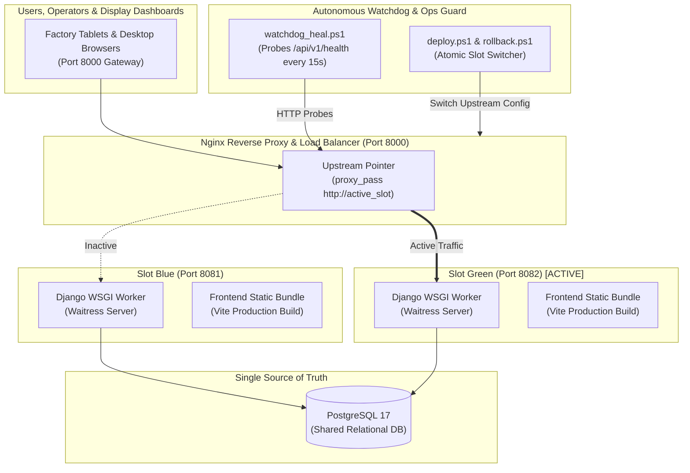

# Zero-Downtime Blue-Green Deployment & Autonomous Watchdog Specification

## 1. High Availability Architecture in Industrial IoT

Continuous textile finishing plants run 24 hours a day, 7 days a week. Halting the web application or telemetry ingestion workers during software updates risks losing machine telemetries, corrupting active batch state machines, and distorting cost calculations.

To guarantee **100% uptime (Zero Downtime)** during updates, Plant Monitor employs an automated **Dual-Slot Blue-Green Architecture** controlled by PowerShell automation and an Nginx reverse proxy.



---

## 2. Slot Definition & Infrastructure Topology

| Slot | Port | Status Tracker | Service Instance | Upstream Config |
| :--- | :--- | :--- | :--- | :--- |
| **Blue** | `8081` | `.active_slot.txt` contains `blue` | Waitress Service A | `upstream backend { server 127.0.0.1:8081; }` |
| **Green** | `8082` | `.active_slot.txt` contains `green` | Waitress Service B | `upstream backend { server 127.0.0.1:8082; }` |
| **Gateway** | `8000` | N/A | Nginx Reverse Proxy | Proxies `/` and `/api/` to the currently active slot |

---

## 3. Automated Deployment Lifecycle (`deploy.ps1`)

The deployment automation script [`deploy.ps1`](file:///c:/Users/HP/Documents/Plant-Monitor/plant-monitor/deploy.ps1) executes the following deterministic steps:

1. **Active Slot Discovery**: Reads `.active_slot.txt` to identify which slot is currently serving production traffic (e.g., `green`).
2. **Inactive Target Selection**: Targets the idle slot (e.g., `blue` on port 8081).
3. **Database Migration Gate**: Runs `manage.py migrate --noinput` to ensure schema compatibility before starting code.
4. **Frontend Asset Compilation**: Compiles the React application with Vite into `frontend/dist/`.
5. **Inactive Slot Service Launch**: Spawns the Waitress WSGI server on the target port (8081).
6. **Health Check Verification Gate**: Probes `http://127.0.0.1:8081/api/v1/health` with exponential backoff (up to 10 attempts).
   - If the endpoint returns `HTTP 200` (`status: healthy` and DB connectivity verified), proceed.
   - If the endpoint fails or times out, the deployment immediately aborts without touching production traffic.
7. **Atomic Traffic Switch**:
   - Updates the Nginx configuration snippet: `server 127.0.0.1:8081;`.
   - Issues `nginx -s reload` (sub-millisecond seamless connection handover).
8. **State Persist**: Overwrites `.active_slot.txt` with `blue`.
9. **Idle Slot Graceful Termination**: Terminates old processes on port 8082 after draining connections.

---

## 4. Instant Atomic Rollback (`rollback.ps1`)

If an unexpected runtime regression occurs post-deployment, the operator can execute [`rollback.ps1`](file:///c:/Users/HP/Documents/Plant-Monitor/plant-monitor/rollback.ps1):
1. Reads previous slot from deployment logs.
2. Re-points Nginx upstream config back to the previous port.
3. Reloads Nginx (`nginx -s reload`).
4. **Recovery Time Objective (RTO)**: **$< 1.5 \text{ seconds}$**.

---

## 5. Autonomous Self-Healing Watchdog (`watchdog_heal.ps1`)

The watchdog script [`watchdog_heal.ps1`](file:///c:/Users/HP/Documents/Plant-Monitor/plant-monitor/watchdog_heal.ps1) operates as an independent background daemon:

```mermaid
sequenceDiagram
    participant Watchdog as watchdog_heal.ps1
    participant Gateway as Nginx (Port 8000)
    participant Active as Active Slot (Port 8082)
    participant Alt as Alternate Slot (Port 8081)

    loop Every 15 Seconds
        Watchdog->>Gateway: GET /api/v1/health
        Gateway->>Active: Proxy Request
        alt Normal Response (HTTP 200)
            Active-->>Watchdog: {"status": "healthy", "database": "connected"}
            Note over Watchdog: Reset failure counter to 0
        else Failure or Timeout (3 Consecutive)
            Active--xWatchdog: Connection Refused / 503 / Timeout
            Note over Watchdog: FailCount = 3 -> Trigger Self-Healing
            Watchdog->>Active: Force-Kill Process
            Watchdog->>Alt: Spin up Alternate Slot
            Watchdog->>Gateway: Switch Nginx Upstream
            Watchdog->>Gateway: nginx -s reload
            Note over Watchdog: Service restored autonomously!
        end
    end
```

### Self-Healing Logic
- **Health Interval**: 15 seconds.
- **Degraded Threshold**: 3 consecutive failed probes.
- **Healing Actions**:
  1. Captures process memory dump and error log.
  2. Spawns replacement WSGI workers.
  3. Validates database pool reconnection.
  4. Flushes Redis / in-memory cache if stale.
  5. Sends diagnostic alert to system logs.

---

## 6. Operational Verification Commands

```powershell
# Check current active slot
Get-Content .active_slot.txt

# Run full health check across gateway
curl.exe -i http://localhost:8000/api/v1/health

# Inspect Nginx upstream routing
Get-Content conf/nginx.conf

# Start watchdog in background
powershell.exe -ExecutionPolicy Bypass -File .\watchdog_heal.ps1
```
