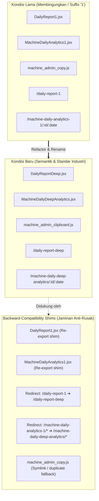

# Implementation Plan: Fase 1 — Testing Guard & Penataan Semantik File Varian (*1 & _copy)

Dokumen ini merinci rencana teknis pelaksanaan **Fase 1**. Sesuai standar *Tech Lead*, implementasi ini memprioritaskan pembuatan **Testing Suite terlebih dahulu (*Test-First / Regression Guard*)**, diikuti dengan penataan ulang file varian (`*1.jsx`, `_copy.js`) menjadi nama semantik tanpa memutus kompatibilitas (*zero-downtime & zero-broken-links*).

---

## 1. Arsitektur Pemetaan: File Lama ➔ File Baru & Alur Interaksi

Berikut adalah peta menyeluruh seluruh file, rute, dan komponen yang terlibat dalam Fase 1:

---

## 2. Rangkaian Pengujian Otomatis (*Test-First Regression Guard*)

Sebelum menyentuh satu pun baris kode produksi, kita akan membangun **3 file unit testing** di backend dan **1 skrip verifikasi build** di frontend untuk memastikan tidak ada logika bisnis atau aset yang rusak selama proses refactoring.

### A. Test Suite 1: Mesin Fisika & Perbaikan Parameter PINN
* **File Target:** `monitoring/tests/test_pinn_engine.py`
* **Kriteria Uji:**
  1. `test_get_hfg_enthalpy_formula`: Memvalidasi rumus entalpi uap jenuh `hfg = 2257 - 37 * p` dan clipping saat `p < 0`.
  2. `test_mlp_forward_shape_and_softplus`: Memvalidasi input normalisasi `(N, 4)` dan output Softplus non-negatif.
  3. `test_predict_three_layers_weights_not_wiped`: **Regression test kritis** untuk memastikan bug penimpaan paksa `own_weights = None` di baris 316–317 telah diperbaiki.

### B. Test Suite 2: Kalkulasi Metrik Energi & Biaya Listrik
* **File Target:** `monitoring/tests/test_electricity_metrics.py`
* **Kriteria Uji:**
  1. `test_fabric_allowance_cap`: Memvalidasi durasi keluar-masuk kain (cooling <70°C s/d stop) dibatasi maksimal **45.0 menit**.
  2. `test_lwbp_and_wbp_cost_split`: Memvalidasi pembagian tarif LWBP dan rasio WBP 1.4x.
  3. `test_zero_duration_fallback`: Memvalidasi penanganan data bernilai `None` tanpa menghasilkan *divide-by-zero*.

### C. Test Suite 3: Verifikasi Rute URL & Aset Static Admin
* **File Target:** `monitoring/tests/test_admin_and_routes.py`
* **Kriteria Uji:**
  1. `test_machine_admin_script_exists`: Memastikan file `machine_admin_clipboard.js` ada di folder static dan template `change_list.html` merujuk ke file yang valid (status HTTP 200).
  2. `test_ninja_api_health_status`: Memastikan endpoint `/api/status` dan `/api/health` tetap berjalan normal.

### D. Frontend Build Smoke Test
* **Perintah Uji:** `npm --prefix frontend run build`
* **Kriteria Uji:** Build Vite harus menghasilkan exit code `0` tanpa galat *unresolved import*, *missing module*, atau *syntax error*.

---

## 3. Matriks Detail Perubahan Kode & Rute per File

### Entitas 1: `DailyReport1.jsx` ➔ `DailyReportDeep.jsx`

| Komponen / File | Baris | Kode Eksisting (Lama) | Rencana Kode Baru |
| :--- | :---: | :--- | :--- |
| **File Fisik** | - | `frontend/src/pages/DailyReport1.jsx` | Telah di-rename secara bersih menjadi `frontend/src/pages/DailyReportDeep.jsx` (file shim sementara telah dihapus untuk menjaga riwayat Git rename). |
| `frontend/src/App.jsx` | L54 | `const DailyReport1 = lazyWithRetry(() => import('./pages/DailyReport1'), 'DailyReport1');` | `const DailyReportDeep = lazyWithRetry(() => import('./pages/DailyReportDeep'), 'DailyReportDeep');` |
| `frontend/src/App.jsx` | L112 | `{ path: '/daily-report-1', element: <DailyReport1 />, pageCode: 'daily_report' },` | `{ path: '/daily-report-deep', element: <DailyReportDeep />, pageCode: 'daily_report' },` `{ path: '/daily-report-1', element: <Navigate to="/daily-report-deep" replace /> },` |
| `NavbarNested.jsx` | L44 | `{ label: 'Daily Report V2 (Deep)', path: '/daily-report-1', icon: Compass, pageCode: 'daily_report' },` | `{ label: 'Daily Report V2 (Deep)', path: '/daily-report-deep', icon: Compass, pageCode: 'daily_report' },` |
| `DailyReport.jsx` | L804 | `href="/daily-report-1"` | `href="/daily-report-deep"` |
| `DailyReportDeep.jsx` (internal) | L28, L33, L41 | `export default function DailyReport1()` `sessionStorage.getItem('dailyReport1Date')` | `export default function DailyReportDeep()` `sessionStorage.getItem('dailyReportDeepDate') \|\| sessionStorage.getItem('dailyReport1Date')` |
| `DailyReportDeep.jsx` (internal) | L459 | `navigate('/machine-daily-analytics-1/${machineId}/${selectedDate}');` | `navigate('/machine-daily-deep-analytics/${machineId}/${selectedDate}');` |

---

### Entitas 2: `MachineDailyAnalytics1.jsx` ➔ `MachineDailyDeepAnalytics.jsx`

| Komponen / File | Baris | Kode Eksisting (Lama) | Rencana Kode Baru |
| :--- | :---: | :--- | :--- |
| **File Fisik** | - | `frontend/src/pages/MachineDailyAnalytics1.jsx` | Telah di-rename secara bersih menjadi `frontend/src/pages/MachineDailyDeepAnalytics.jsx` (file shim sementara telah dihapus untuk menjaga riwayat Git rename). |
| `frontend/src/App.jsx` | L62 | `const MachineDailyAnalytics1 = lazyWithRetry(() => import('./pages/MachineDailyAnalytics1'), 'MachineDailyAnalytics1');` | `const MachineDailyDeepAnalytics = lazyWithRetry(() => import('./pages/MachineDailyDeepAnalytics'), 'MachineDailyDeepAnalytics');` |
| `frontend/src/App.jsx` | L115 | `{ path: '/machine-daily-analytics-1/:machineId/:date', element: <MachineDailyAnalytics1 />, pageCode: 'daily_report' },` | `{ path: '/machine-daily-deep-analytics/:machineId/:date', element: <MachineDailyDeepAnalytics />, pageCode: 'daily_report' },` `{ path: '/machine-daily-analytics-1/:machineId/:date', element: <LegacyMachineDeepRedirect /> },` |
| `MachineDailyAnalytics.jsx` | L278 | `onClick={() => navigate('/machine-daily-analytics-1/${machineId}/${date}')}` | `onClick={() => navigate('/machine-daily-deep-analytics/${machineId}/${date}')}` |
| `MachineDailyDeepAnalytics.jsx` | L43 | `export default function MachineDailyAnalytics1()` | `export default function MachineDailyDeepAnalytics()` |
| `MachineDailyDeepAnalytics.jsx` | L77, L227 | `navigate('/machine-daily-analytics-1/${machineId}/${nextDate}')` | `navigate('/machine-daily-deep-analytics/${machineId}/${nextDate}')` |
| `MachineDailyDeepAnalytics.jsx` | L165, L182 | `navigate("/daily-report-1")` `navigate('/daily-report-1')` | `navigate("/daily-report-deep")` `navigate('/daily-report-deep')` |

---

### Entitas 3: `machine_admin_copy.js` ➔ `machine_admin_clipboard.js`

> **Klarifikasi Tujuan:** Kata `copy` pada file ini ternyata merujuk ke fitur **"Copy Selected to Clipboard"** (ekspor data baris mesin ke Excel/Google Sheets melalui clipboard) di Django Admin. Nama semantik baru **`machine_admin_clipboard.js`** menegaskan fungsi ini dan menghilangkan kesan "file cadangan/copyan".

| Komponen / File | Baris | Kode Eksisting (Lama) | Rencana Kode Baru |
| :--- | :---: | :--- | :--- |
| **File Fisik** | - | `monitoring/static/admin/js/machine_admin_copy.js` | Telah di-rename menjadi `monitoring/static/admin/js/machine_admin_clipboard.js` (file nama lama telah dihapus). |
| `change_list.html` | L6 | `` | `` |

---

### Entitas 4: Dockerfile & Unifikasi Requirements

| Komponen / File | Baris | Kode Eksisting (Lama) | Rencana Kode Baru |
| :--- | :---: | :--- | :--- |
| `requirements.txt` | Semua | Versi lokal lengkap | Dipastikan berisi seluruh dependensi (`django-ninja`, `django-cors-headers`, `scipy`, dll.) sebagai *Single Source of Truth*. |
| `Dockerfile` | L16, L19 | `COPY requirements_clean.txt .` `RUN pip install ... -r requirements_clean.txt ...` | `COPY requirements.txt .` `RUN pip install ... -r requirements.txt ...` |
| Root files | - | `requirements_clean.txt` `requirements_fixed.txt` | Diarsipkan ke `archive/requirements_legacy/`. |

---

## 4. Tahapan Eksekusi Bertahap (Execution Checklist)

- [ ] **Langkah 1: Setup Test Suite (Regression Guard)**
  - [ ] Buat file `monitoring/tests/test_pinn_engine.py`.
  - [ ] Buat file `monitoring/tests/test_electricity_metrics.py`.
  - [ ] Buat file `monitoring/tests/test_admin_and_routes.py`.
  - [ ] Jalankan test suite untuk memastikan seluruh tes awal berstatus **PASS**.
- [ ] **Langkah 2: Perbaiki Bug PINN `predict_three_layers`**
  - [ ] Hapus baris penimpaan `own_weights = None` & `best_weights = None` di `monitoring/services/pinn_engine.py` (L316–L317).
  - [ ] Validasi ulang dengan `test_pinn_engine.py`.
- [ ] **Langkah 3: Refactor Static Admin JS**
  - [ ] Salin `machine_admin_copy.js` menjadi `machine_admin_clipboard.js`.
  - [ ] Perbarui tag script di `monitoring/templates/admin/monitoring/machine/change_list.html`.
  - [ ] Verifikasi via `test_admin_and_routes.py`.
- [ ] **Langkah 4: Refactor Frontend Pages & Routing**
  - [ ] Rename `DailyReport1.jsx` ➔ `DailyReportDeep.jsx` & buat file shim `DailyReport1.jsx`.
  - [ ] Rename `MachineDailyAnalytics1.jsx` ➔ `MachineDailyDeepAnalytics.jsx` & buat file shim `MachineDailyAnalytics1.jsx`.
  - [ ] Perbarui rute dan komponen redirect di `frontend/src/App.jsx`.
  - [ ] Perbarui tautan di `NavbarNested.jsx`, `DailyReport.jsx`, dan `MachineDailyAnalytics.jsx`.
- [ ] **Langkah 5: Unifikasi Dockerfile & Requirements**
  - [ ] Perbarui `Dockerfile` agar merujuk ke `requirements.txt`.
  - [ ] Pindahkan `requirements_clean.txt` dan `requirements_fixed.txt` ke folder `archive/`.
- [ ] **Langkah 6: Verifikasi Akhir**
  - [ ] Jalankan `npm run build` di frontend (harus sukses 100%).
  - [ ] Jalankan seluruh Django test suite.

---

## 5. Rencana Rollback (Safety Net)

1. Setiap file lama tetap memiliki **file shim** (`DailyReport1.jsx` dan `MachineDailyAnalytics1.jsx`) yang mengekspor komponen baru, sehingga setiap pemanggilan tak terduga tidak akan menghasilkan error *module not found*.
2. Rute URL lama (`/daily-report-1` dan `/machine-daily-analytics-1/*`) memiliki `Navigate replace` ke rute baru, menjaga kompatibilitas bookmark browser pengguna lama.
3. File `machine_admin_copy.js` tidak langsung dihapus sampai `machine_admin_clipboard.js` terbukti stabil di browser admin.
