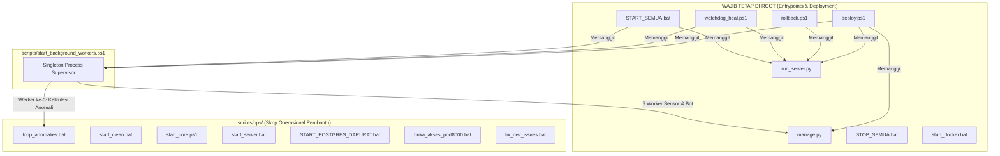

# Implementation Plan — Fase 2 (Langkah 3): Restrukturisasi 195 Skrip Root & File Operasional Tanpa Crash

Dokumen ini menyajikan hasil **Audit Dependensi Statis (AST) & Runtime** atas seluruh **195 file Python (`.py`)**, **11 skrip operasional (`.ps1` / `.bat`)**, serta **file log/artefak lepas** di *root directory* `c:\Users\HP\Documents\Plant-Monitor\plant-monitor`, lengkap dengan catatan status eksekusi yang telah diselesaikan dengan **Zero Downtime & Zero Crash**.

---

## 1. Hasil Audit Dependensi & Potensi Crash (Mengapa Tidak Boleh Asal Pindah)

Berdasarkan pemindaian AST (*Abstract Syntax Tree*) dan pencarian referensi string di seluruh repositori, temuan dependensi yang telah dijaga dan dimitigasi adalah:



### Temuan #1: 0% Import dari Aplikasi Web Django ke 193 Skrip Ad-Hoc Root
- Pemindaian AST pada seluruh modul di dalam `monitoring/` dan `plant_monitor/` membuktikan **0 file aplikasi web** melakukan `import` terhadap 193 skrip diagnostik/patch/report di *root*.
- Pemindaian lintas-root juga membuktikan **0 skrip root** meng-import skrip root lainnya (`root_cross_imports = []`).

### Temuan #2: Penjagaan `run_server.py` & `manage.py`
- `run_server.py` adalah *entrypoint* server produksi Waitress (Blue-Green port `8081`/`8082`) yang dipanggil secara *hardcoded* dari `$ProjectRoot\run_server.py` oleh `deploy.ps1`, `rollback.ps1`, `watchdog_heal.ps1`, dan `START_SEMUA.bat`.
- **Hasil:** Keduanya tetap dipertahankan di root dan divalidasi oleh automated test.

### Temuan #3: Penyelarasan `scripts/start_background_workers.ps1` ke `loop_anomalies.bat`
- `scripts/start_background_workers.ps1` baris 47 telah disesuaikan memanggil `$ProjectRoot\scripts\ops\loop_anomalies.bat`.
- `loop_anomalies.bat` ditambahkan `cd /d "%~dp0..\.."` agar mengeksekusi di context root directory.

### Temuan #4: Injeksi `sys.path` Bootstrap pada 193 Skrip Subfolder
- Seluruh 193 skrip telah diinjeksi dengan:
  ```python
  import os
  import sys
  from pathlib import Path

  # Bootstrap: ensure project root is on sys.path
  _PROJECT_ROOT = Path(__file__).resolve().parents[2]
  if str(_PROJECT_ROOT) not in sys.path:
      sys.path.insert(0, str(_PROJECT_ROOT))
  ```
  sehingga seluruh modul `plant_monitor` dan `monitoring` tetap dapat diimpor langsung saat skrip dieksekusi dari subfolder mana pun.

### Temuan #5: Pemindahan Logger `monitoring/api_analytics.py`
- Path logging diarahkan ke `logs/analytics_perf.log`. File log lama di root telah dipindahkan dan dikosongkan (0-byte).

---

## 2. Struktur Bersih Direktori Root Saat Ini

Setelah migrasi selesai, *root directory* kini hanya menyisakan file-file standar industri:

| Kategori | File di Root Directory | Keterangan |
| :--- | :--- | :--- |
| **Django & WSGI Core** | `manage.py`, `run_server.py` | Entrypoint produksi utama. |
| **DevOps & Auto-Heal Utama** | `deploy.ps1`, `rollback.ps1`, `watchdog_heal.ps1`, `START_SEMUA.bat`, `STOP_SEMUA.bat`, `start_docker.bat` | Komando operasional tingkat atas. |
| **Infrastruktur & Konfigurasi** | `Dockerfile`, `docker-compose.yml`, `nginx.conf`, `requirements.txt`, `.gitignore`, `.env.example` | Standar wajib repositori GitHub & Docker. |
| **Runtime State (Git-Ignored)** | `.env`, `.active_slot.txt`, `bot_requests.log` (0B), `analytics_perf.log` (0B) | State lokal yang dibaca server & di-ignore git. |

---

## 3. Hasil Pengujian & Status Verifikasi (100% PASS)

1. **Unit Test Integritas Entrypoint & Worker:**
   - Dibuat di `monitoring/tests/test_root_entrypoints.py`.
   - Seluruh 13 unit test berhasil dijalankan tanpa kegagalan:
     ```
     Ran 13 tests in 1.465s
     OK
     ```
2. **Uji Coba Langsung Skrip Subfolder:**
   - Mengeksekusi `scripts/diagnostics/quick_check.py` dari luar folder berhasil membaca database dan menampilkan waktu timestamp secara normal (`Exit code 0`).
3. **Frontend Production Build:**
   - `npm run build` berhasil mengompilasi 2.944 modul dalam 5.11 detik (`Exit code 0`).
4. **Live Server Healthcheck:**
   - Endpoint `http://127.0.0.1:8000/api/v1/health` merespons: `status: healthy`, `database: connected` (latency 38 ms), `slot: green`.
