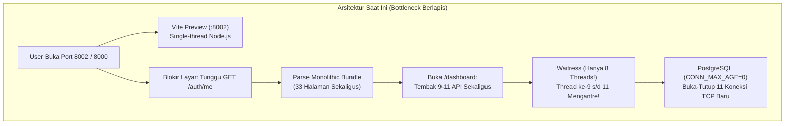

# Analisis Mendalam Performa, Arsitektur, API & UX Website React (Port 8000 & 8002) vs HTML SSR (Port 8004)

Dokumen ini menyajikan hasil audit menyeluruh terhadap seluruh lapisan aplikasi **Plant-Monitor**—mulai dari konfigurasi server/jaringan, *bundling* & *state management* React, setiap halaman/menu, hingga query database PostgreSQL dan endpoint API Django—untuk menjawab mengapa pengguna merasakan **Port 8000 / 8002 (React SPA) lambat, banyak *loading* berulang, *lag*, dan memiliki bug kecil** dibandingkan **Port 8004 (Django HTML SSR)**.

---

## Ringkasan Eksekutif: Mengapa Port 8004 Terasa Cepat Sedangkan Port 8000/8002 Terasa Lambat?

Perbedaan kecepatan yang dirasakan pengguna bukan karena React secara bawaan lebih lambat dari HTML biasa, melainkan karena **kombinasi 5 masalah arsitektural utama** yang saat ini terjadi bersamaan di Port 8000 & 8002:

| Aspek | Port 8004 (Django HTML SSR) | Port 8000 & 8002 (React SPA Saat Ini) | Dampak ke Pengguna |
| :--- | :--- | :--- | :--- |
| **1. Jumlah Request per Halaman** | **1 HTTP Request** per halaman (HTML langsung berisi data matang dari server). | **4 hingga 11 HTTP Request paralel** per halaman (`/auth/me`, `/branding` 2–3x, plus 3–9 API data). | **Antrean Server (*Thread Starvation*)**: Waitress hanya punya **8 thread**. Satu orang membuka `/dashboard` (11 request) langsung menyumbat seluruh thread server! |
| **2. Koneksi Database PostgreSQL** | 1 halaman = **1 koneksi TCP/DB** baru. | 1 halaman = **5–11 koneksi TCP/DB** baru karena `CONN_MAX_AGE` belum diset (default `0`). | Setiap klik menu memicu *handshake* koneksi PostgreSQL berulang kali + query tabel `django_session` di tiap request. |
| **3. Cara Serving File Statis** | Dilayani langsung oleh Waitress/WhiteNoise dalam 1 dokumen HTML kecil. | Dilayani oleh **`vite preview` (Node.js dev preview server)** di port 8002, bahkan saat diakses lewat Nginx port 8000! | `vite preview` bukan server produksi. Jika pengguna membuka `:8002` langsung, kompresi `gzip` Nginx terlewati dan setiap API terkena penalti **CORS Preflight (`OPTIONS`)**. |
| **4. Caching saat Pindah Menu** | Browser meng-render HTML langsung. | **80% halaman memakai `axios` mentah (`useEffect` + `useState`) tanpa cache**. Hanya 6 halaman yang memakai RTK Query. | Saat pindah dari Menu A $\rightarrow$ Menu B $\rightarrow$ kembali ke Menu A, state terhapus dan pengguna dipaksa melihat *loading spinner* penuh dari awal lagi. |
| **5. Ukuran Bundle Awal** | Hanya memuat JS/CSS yang dipakai halaman tersebut. | **33 halaman di-import secara statis** di [`App.jsx`](file:///c:/Users/HP/Documents/Plant-Monitor/plant-monitor/frontend/src/App.jsx#L1-L58) tanpa `React.lazy` (*Zero Code-Splitting*). | Buka pertama kali harus mengunduh & mem-parsing seluruh library (`chart.js`, `recharts`, `xlsx`, `tanstack-table`) sekaligus. |



---

## Bagian 1: Analisis Infrastruktur, Jaringan & Server (Port 8000 vs 8002 vs 8004)

### 1.1. Penggunaan `vite preview` di Produksi & Konfigurasi Nginx
* **Lokasi Kode:** [`START_SEMUA.bat`](file:///c:/Users/HP/Documents/Plant-Monitor/plant-monitor/START_SEMUA.bat#L36-L56) dan [`nginx.conf`](file:///c:/Users/HP/Downloads/nginx-1.28.2/nginx-1.28.2/conf/nginx.conf#L60-L82).
* **Temuan:**
  1. Di [`START_SEMUA.bat`](file:///c:/Users/HP/Documents/Plant-Monitor/plant-monitor/START_SEMUA.bat#L39), frontend dijalankan dengan `npm run preview -- --host --port 8002` (dan port 8003). Dokumentasi resmi Vite menegaskan bahwa `vite preview` hanya untuk pratinjau lokal di komputer developer, **bukan untuk melayani trafik produksi multi-user**.
  2. Di [`nginx.conf`](file:///c:/Users/HP/Downloads/nginx-1.28.2/nginx-1.28.2/conf/nginx.conf#L60-L67), blok `location /` melakukan `proxy_pass http://127.0.0.1:8002;` alih-alih membaca folder hasil build `frontend/dist` secara langsung dari disk (`root ...; try_files $uri /index.html;`). Akibatnya setiap request file JS/CSS harus melewati *hop* jaringan tambahan Nginx $\rightarrow$ Node.js Vite.
  3. **Masalah Khusus Port 8002:** Ketika pengguna mengakses `http://<ip-server>:8002` secara langsung (bukan `:8000`):
     * Seluruh fitur Nginx (`gzip on`, buffer, caching asset statis 30 hari) **terlewati sama sekali**.
     * Di [`frontend/src/lib/api.js`](file:///c:/Users/HP/Documents/Plant-Monitor/plant-monitor/frontend/src/lib/api.js#L4-L16), karena port-nya `8002`, Axios mengarahkan `baseURL` ke `http://${hostname}:8000/api/v1`. Bagi browser, port `8002` $\rightarrow$ `8000` adalah **Cross-Origin (beda origin)**! Akibatnya setiap request API (terutama yang membawa header/credentials) memicu **CORS Preflight (`OPTIONS` request)** terlebih dahulu—menggandakan latensi jaringan!

### 1.2. *Thread Pool Starvation* pada Waitress (`threads=8`)
* **Lokasi Kode:** [`run_server.py`](file:///c:/Users/HP/Documents/Plant-Monitor/plant-monitor/run_server.py#L14-L19).
* **Temuan:**
  ```python
  serve(application, host='0.0.0.0', port=port, threads=8)
  ```
  Waitress dikonfigurasi hanya dengan **8 worker threads** untuk melayani seluruh API di port 8001.
* **Mengapa Ini Menyebabkan Gejala "Menunggu Kelamaan":**
  * Pada arsitektur React SPA saat ini, membuka satu halaman seperti [`Dashboard.jsx`](file:///c:/Users/HP/Documents/Plant-Monitor/plant-monitor/frontend/src/pages/Dashboard.jsx#L117-L129) memicu **9 API call paralel** ditambah `/auth/me` dan `/branding` (**total 11 request serentak dari 1 browser**).
  * Jika ada **2 pengguna saja** membuka Dashboard atau Grafik secara bersamaan (20+ request paralel), sementara 2–3 thread sedang tertahan menghitung agregasi berat (seperti `steam-hto` yang memakan **1.000–3.400 ms** berdasarkan [`analytics_perf.log`](file:///c:/Users/HP/Documents/Plant-Monitor/plant-monitor/analytics_perf.log#L88-L95) atau `steam-sales` di Dashboard), maka **seluruh 8 thread Waitress langsung penuh 100%**.
  * Request ringan seperti klik menu atau cek login dari pengguna ke-3 harus mengantre di *socket queue* selama beberapa detik hingga thread selesai. Inilah penyebab utama keluhan *"kadang menunggu kelamaan padahal cuma buka menu"*.

### 1.3. Koneksi Database Tidak Persisten (`CONN_MAX_AGE = 0`)
* **Lokasi Kode:** [`plant_monitor/settings.py`](file:///c:/Users/HP/Documents/Plant-Monitor/plant-monitor/plant_monitor/settings.py#L130-L143).
* **Temuan:** Konfigurasi `DATABASES['default']` tidak menyertakan `CONN_MAX_AGE`. Secara default di Django, `CONN_MAX_AGE = 0`, yang berarti Django **membuka koneksi TCP + autentikasi PostgreSQL baru di awal setiap HTTP request dan menutupnya di akhir request**.
* **Dampak:** Karena 1 halaman React memicu hingga 10 HTTP request API, PostgreSQL harus melayani 10x *connection handshake* per halaman. Menambahkan `'CONN_MAX_AGE': 600` (atau `CONN_HEALTH_CHECKS = True`) akan menggunakan kembali koneksi yang sudah terbuka dan memangkas *overhead* 15–40 ms di setiap request API.

### 1.4. `SESSION_ENGINE` Masih ke Database & `DEBUG = True`
* **Lokasi Kode:** [`plant_monitor/settings.py`](file:///c:/Users/HP/Documents/Plant-Monitor/plant-monitor/plant_monitor/settings.py#L28) dan [`plant_monitor/settings.py`](file:///c:/Users/HP/Documents/Plant-Monitor/plant-monitor/plant_monitor/settings.py#L186-L191).
* **Temuan:**
  1. Pada baris 188 tertulis komentar: `# Gunakan file-based session: nol DB query per request`, namun pada baris 191 kodenya masih tertulis:
     ```python
     SESSION_ENGINE = 'django.contrib.sessions.backends.db'
     ```
     Akibatnya setiap panggilan API yang memeriksa `request.user` tetap melakukan query `SELECT ... FROM django_session` ke PostgreSQL.
  2. Pada baris 28, `DEBUG = os.environ.get('DJANGO_DEBUG', 'True') == 'True'`. Ketika dijalankan dari [`START_SEMUA.bat`](file:///c:/Users/HP/Documents/Plant-Monitor/plant-monitor/START_SEMUA.bat), `DJANGO_DEBUG` tidak diset sehingga `DEBUG` bernilai `True`. Di mode `DEBUG=True`, Django menyimpan seluruh riwayat string SQL query di memori (`connection.queries`) dan menonaktifkan optimasi internal.

---

## Bagian 2: Analisis Arsitektur Frontend React (Bundle, State, Caching & Navigasi)

### 2.1. Tidak Ada *Code-Splitting* (`React.lazy`) di `App.jsx`
* **Lokasi Kode:** [`frontend/src/App.jsx`](file:///c:/Users/HP/Documents/Plant-Monitor/plant-monitor/frontend/src/App.jsx#L1-L58) dan [`frontend/vite.config.js`](file:///c:/Users/HP/Documents/Plant-Monitor/plant-monitor/frontend/vite.config.js#L1-L26).
* **Temuan:** Seluruh **33 komponen halaman** di-import secara statis di bagian atas `App.jsx`. Library berat seperti `chart.js`, `recharts`, `xlsx` (SheetJS), `@tanstack/react-table`, dan `driver.js` ikut tergabung dalam beban unduhan awal.
* **Solusi:** Mengubah seluruh import halaman di `App.jsx` menjadi `React.lazy(() => import('./pages/...'))` dengan `<Suspense>` serta menambahkan `manualChunks` di `vite.config.js` akan mengecilkan ukuran bundle awal hingga **70–80%**.

### 2.2. *Render-Blocking* pada `AuthContext` & Panggilan `/branding` Ganda
* **Lokasi Kode:**
  * [`frontend/src/context/AuthContext.jsx`](file:///c:/Users/HP/Documents/Plant-Monitor/plant-monitor/frontend/src/context/AuthContext.jsx#L86-L90)
  * [`frontend/src/main.jsx`](file:///c:/Users/HP/Documents/Plant-Monitor/plant-monitor/frontend/src/main.jsx#L22-L54)
  * [`frontend/src/components/sidebar/NavbarNested.jsx`](file:///c:/Users/HP/Documents/Plant-Monitor/plant-monitor/frontend/src/components/sidebar/NavbarNested.jsx#L117-L129)
  * [`frontend/src/components/sidebar/MobileHeader.jsx`](file:///c:/Users/HP/Documents/Plant-Monitor/plant-monitor/frontend/src/components/sidebar/MobileHeader.jsx#L16-L24)
* **Temuan:**
  1. Di [`AuthContext.jsx`](file:///c:/Users/HP/Documents/Plant-Monitor/plant-monitor/frontend/src/context/AuthContext.jsx#L88): `{!loading && children}` menahan seluruh render aplikasi (layar putih kosong) sampai request `GET /api/v1/auth/me` selesai. Jika server sedang sibuk, pengguna hanya melihat layar kosong tanpa kerangka *sidebar*.
  2. Endpoint `GET /api/v1/branding` dipanggil **3 kali secara terpisah** tanpa berbagi cache: sekali di `main.jsx`, sekali di `NavbarNested.jsx`, dan sekali lagi di `MobileHeader.jsx`.

### 2.3. Ketidakseragaman Data Fetching (Penyebab "Harus Loading Lagi Lama" Saat Pindah Menu)
* **Lokasi Kode:** [`frontend/src/store/apiSlice.js`](file:///c:/Users/HP/Documents/Plant-Monitor/plant-monitor/frontend/src/store/apiSlice.js#L1-L26).
* **Temuan:** Redux Toolkit Query (`apiSlice`) sebenarnya sudah dipasang, tetapi **hanya digunakan di 6 halaman** (`AnalyticsGrafik`, `DailyBatchOverview`, `ManualMachineUsage`, `PerformanceSummary`, `ProductionPlanning`, `SnapshotHistoryPivot`).
* **Lebih dari 20 halaman lainnya** (`Home`, `Dashboard`, `DailyReport`, `MonthlyReport`, `MachineDailyReport`, `BoilerReport`, `BoilerCalendar`, `HistoryList`, `ProcessReport`, dll.) masih menggunakan `useEffect` + `api.get()` + `useState(loading = true)`.
* **Apa yang Terjadi Saat User Berpindah Menu:**
  * Di halaman berbasis `useEffect` + `useState`, seluruh data disimpan di *local component state*.
  * Begitu pengguna mengklik menu lain (misal dari **Daily Report** ke **History**, lalu kembali ke **Daily Report** 5 detik kemudian), komponen `DailyReport` di-*unmount* (state hilang) dan di-*mount* ulang dari nol, menampilkan *skeleton/spinner* penuh dan memicu 3 query berat ulang ke server!
  * Bahkan untuk halaman yang sudah memakai RTK Query, `keepUnusedDataFor` di [`apiSlice.js`](file:///c:/Users/HP/Documents/Plant-Monitor/plant-monitor/frontend/src/store/apiSlice.js) belum dinaikkan (default hanya 60 detik).

### 2.4. Penggunaan `window.location.href` dan `window.location.reload()` yang Merusak SPA
* **Lokasi Kode:**
  * [`frontend/src/pages/DailyReport.jsx`](file:///c:/Users/HP/Documents/Plant-Monitor/plant-monitor/frontend/src/pages/DailyReport.jsx#L541): `window.location.href = '/machine-daily-analytics/...'` saat klik baris mesin.
  * [`frontend/src/pages/Dashboard.jsx`](file:///c:/Users/HP/Documents/Plant-Monitor/plant-monitor/frontend/src/pages/Dashboard.jsx#L684): `onClick={() => window.location.reload()}` pada tombol Refresh di header Dashboard.
* **Dampak:** Alih-alih berpindah halaman secara instan via React Router (`navigate(...)`) atau memanggil fungsi `fetchDashboardData()`, kode tersebut memaksa browser melakukan **hard reload seluruh tab**, menghapus seluruh cache Redux/RTK Query, mengunduh ulang bundle, dan memanggil `/auth/me` serta `/branding` dari awal.

---

## Bagian 3: Analisis Mendalam Per Menu, Halaman & Endpoint API Backend

Berikut adalah bedah performa dan masalah spesifik di setiap menu utama aplikasi:

### 3.1. Menu **Home** (`/home` $\rightarrow$ [`Home.jsx`](file:///c:/Users/HP/Documents/Plant-Monitor/plant-monitor/frontend/src/pages/Home.jsx) & [`views.py:build_home_korlap_payload`](file:///c:/Users/HP/Documents/Plant-Monitor/plant-monitor/monitoring/views.py#L276-L754))
1. **Query `MachineMinuteLog` 24 Jam Penuh untuk Seluruh Mesin:**
   * Di [`views.py` baris 352](file:///c:/Users/HP/Documents/Plant-Monitor/plant-monitor/monitoring/views.py#L351-L357):
     ```python
     recent_logs = MachineMinuteLog.objects.filter(
         timestamp__gte=cutoff, ...
     ).values('machine_id', 'timestamp', 'temperature', 'steam_Usage', 'flow_water')
     ```
     Saat mode periode `1d` (24 jam), fungsi ini menarik log menit selama 24 jam untuk seluruh mesin (bisa mencapai **50.000 – 80.000 baris data** dari PostgreSQL ke memori Python) **hanya untuk menggambar sparkline mini 14 titik** di kartu mesin!
2. **N+1 Query pada `active_batches` (`safe_get_identity`):**
   * Di [`views.py` baris 338](file:///c:/Users/HP/Documents/Plant-Monitor/plant-monitor/monitoring/views.py#L338-L343), query `DyeingProcess.objects.filter(is_complete=False)` **tidak menyertakan `.select_related('identity', 'identity__program')`** (padahal `completed_batches` di baris 344 menyertakannya!).
   * Akibatnya, di dalam perulangan `for m in all_machines:` ([baris 527](file:///c:/Users/HP/Documents/Plant-Monitor/plant-monitor/monitoring/views.py#L527)), pemanggilan `safe_get_identity(active_batch)` mengeksekusi **2 query SQL tambahan per mesin yang sedang jalan**!
3. **Tidak Ada Auto-Polling & Tidak Ada Tombol Refresh:**
   * Di [`Home.jsx` baris 397-416](file:///c:/Users/HP/Documents/Plant-Monitor/plant-monitor/frontend/src/pages/Home.jsx#L397-L416), data hanya di-fetch saat *mount* awal dan saat tab browser pindah (`visibilitychange`). Tidak ada `setInterval` polling, sementara tombol manual refresh sengaja dihapus ([baris 480](file:///c:/Users/HP/Documents/Plant-Monitor/plant-monitor/frontend/src/pages/Home.jsx#L480)). Jika layar monitor pabrik dibiarkan terbuka, data di `/home` membeku (tidak bergerak).

### 3.2. Menu **Dashboard** (`/dashboard` $\rightarrow$ [`Dashboard.jsx`](file:///c:/Users/HP/Documents/Plant-Monitor/plant-monitor/frontend/src/pages/Dashboard.jsx) & [`api_dashboard.py`](file:///c:/Users/HP/Documents/Plant-Monitor/plant-monitor/monitoring/api_dashboard.py))
1. **Stampede 9 Request Sekaligus & *All-or-Nothing* Loading Spinner:**
   * [`Dashboard.jsx` baris 117-129](file:///c:/Users/HP/Documents/Plant-Monitor/plant-monitor/frontend/src/pages/Dashboard.jsx#L117-L129) menembakkan **9 HTTP request sekaligus** di dalam `Promise.all`.
   * Pada [baris 545](file:///c:/Users/HP/Documents/Plant-Monitor/plant-monitor/frontend/src/pages/Dashboard.jsx#L545):
     ```jsx
     if (!trafficData || !salesData || !machinesData) { return <Spinner />; }
     ```
     Artinya, meskipun 8 endpoint sudah selesai dalam 50 ms, **seluruh halaman Dashboard tetap tertahan di layar loading putih** menunggu 1 endpoint paling lambat, yaitu `/dashboard/steam-sales` (`salesData`)!
2. **Kalkulasi Berat Sinkron di Dalam `get_steam_sales`:**
   * Di [`api_dashboard.py` baris 270-361](file:///c:/Users/HP/Documents/Plant-Monitor/plant-monitor/monitoring/api_dashboard.py#L270-L361):
     * Untuk 6 hari ke belakang, jika `DailyPlantMetric` atau `BoilerDailyMetric` belum ada, endpoint GET dashboard ini menghitung `_compute_daily_summary_data` dan `upsert_boiler_daily_metric` **secara sinkron di tengah request user**!
     * Lebih parah lagi, untuk **"Hari Ini"** ([baris 345-361](file:///c:/Users/HP/Documents/Plant-Monitor/plant-monitor/monitoring/api_dashboard.py#L345-L361)), **setiap kali Dashboard dibuka (dan setiap 5 menit sekali)**, kode selalu memanggil `_compute_boiler_chart_data(target_date)` yang memindai seluruh `MachineStatusSnapshot` dan `MachineMinuteLog` hari ini tanpa cache sama sekali!
3. **Request Redundan & Data Palsu (Dummy Random) di `/dashboard/steam-traffic`:**
   * Di [`api_dashboard.py` baris 175-204](file:///c:/Users/HP/Documents/Plant-Monitor/plant-monitor/monitoring/api_dashboard.py#L175-L204), endpoint `/dashboard/steam-traffic` menghasilkan array 24 jam berisi angka acak (`random.random()`) untuk `steam_series`, padahal `Dashboard.jsx` sudah mengambil grafik uap asli dari `/api/steam-usage-history/?hours=24`.
4. **Loop Ganda & N+1 Query di `get_active_machines`:**
   * Di [`api_dashboard.py` baris 607 & 813](file:///c:/Users/HP/Documents/Plant-Monitor/plant-monitor/monitoring/api_dashboard.py#L607-L855), daftar mesin di-loop dua kali. Pada loop kedua ([baris 847](file:///c:/Users/HP/Documents/Plant-Monitor/plant-monitor/monitoring/api_dashboard.py#L847)), fungsi `get_status_since_info(m)` dipanggil untuk setiap mesin. Jika mesin bertipe `MANUAL` dan `status_changed_at` kosong, [`manual_status.py` baris 29](file:///c:/Users/HP/Documents/Plant-Monitor/plant-monitor/monitoring/utils/manual_status.py#L25-L35) melakukan query `MachineManualLog.objects.filter(machine=machine)...first()` satu per satu di dalam loop!

### 3.3. Menu **Analytics / Grafik** (`/grafik` $\rightarrow$ [`AnalyticsGrafik.jsx`](file:///c:/Users/HP/Documents/Plant-Monitor/plant-monitor/frontend/src/pages/AnalyticsGrafik.jsx) & [`api_analytics.py`](file:///c:/Users/HP/Documents/Plant-Monitor/plant-monitor/monitoring/api_analytics.py))
* **Bukti Log Produksi ([`analytics_perf.log`](file:///c:/Users/HP/Documents/Plant-Monitor/plant-monitor/analytics_perf.log#L51-L99)):**
  * Endpoint `steam-hto` membutuhkan **650 ms – 1.089 ms** untuk rentang 24 jam (`snapshots_loaded=1440`), dan melonjak menjadi **2.692 ms – 3.427 ms (3,4 detik!)** untuk rentang 3 hari (`snapshots_loaded=4452`).
  * Penyebabnya: [`api_analytics.py` baris 196-200](file:///c:/Users/HP/Documents/Plant-Monitor/plant-monitor/monitoring/api_analytics.py#L196-L200) memuat seluruh kolom JSON `snapshot_data` yang berukuran besar dari ribuan baris `MachineStatusSnapshot` ke memori Python hanya untuk mengambil nilai `Boiler_Steam` dan `Boiler_HTO` per interval 5 menit!
  * Selain itu, endpoint `graph-multi` mengirimkan payload JSON hingga **1,61 MB** (`resp_bytes=1610030` pada baris 80 log) karena mengirim seluruh titik per menit tanpa *downsampling* (LTTB / agregasi interval) ketika pengguna memilih rentang > 24 jam.

### 3.4. Menu **Daily Report** (`/daily-report` & `/daily-report-1` $\rightarrow$ [`DailyReport.jsx`](file:///c:/Users/HP/Documents/Plant-Monitor/plant-monitor/frontend/src/pages/DailyReport.jsx) & [`api_report.py`](file:///c:/Users/HP/Documents/Plant-Monitor/plant-monitor/monitoring/api_report.py))
1. **Bug Lazy-Load `IntersectionObserver` yang Gagal Berfungsi:**
   * Di [`DailyReport.jsx` baris 516-539](file:///c:/Users/HP/Documents/Plant-Monitor/plant-monitor/frontend/src/pages/DailyReport.jsx#L516-L539), penulis kode berniat menunda pemanggilan `/report/boiler-summary` sampai pengguna men-scroll ke bawah (`boilerInView`).
   * **NAMUN** pada baris 535-538:
     ```jsx
     useEffect(() => {
       if (boilerLoadedDateRef.current === selectedDate) return;
       fetchBoiler(selectedDate);
     }, [boilerInView, selectedDate]);
     ```
     Tidak ada pengecekan `if (!boilerInView) return;`! Akibatnya, begitu halaman dibuka (`boilerInView === false`), `useEffect` tetap langsung mengeksekusi `fetchBoiler(selectedDate)` bersamaan dengan `fetchReport(selectedDate)` dan `fetchAnomalies(selectedDate)`!
2. **N+1 Query di `_compute_daily_summary_data` ([`api_report.py`](file:///c:/Users/HP/Documents/Plant-Monitor/plant-monitor/monitoring/api_report.py)):**
   * [Baris 401](file:///c:/Users/HP/Documents/Plant-Monitor/plant-monitor/monitoring/api_report.py#L400-L402): Melakukan `Machine.objects.filter(group=group, is_active=True)` di dalam loop `for group in groups:`.
   * [Baris 503](file:///c:/Users/HP/Documents/Plant-Monitor/plant-monitor/monitoring/api_report.py#L502-L507): Melakukan query `DyeingProcess.objects.filter(machine=m, ...)` **satu per satu untuk setiap mesin JET** di dalam loop `for m in valid_machines:`.

### 3.5. Menu **Snapshot History** (`/snapshot-history` $\rightarrow$ [`SnapshotHistoryPivot.jsx`](file:///c:/Users/HP/Documents/Plant-Monitor/plant-monitor/frontend/src/pages/SnapshotHistoryPivot.jsx) & [`api_snapshots.py`](file:///c:/Users/HP/Documents/Plant-Monitor/plant-monitor/monitoring/api_snapshots.py))
1. **Timeline Memuat 70.000+ Objek ORM Django Sekaligus:**
   * Di [`api_snapshots.py` baris 434-441](file:///c:/Users/HP/Documents/Plant-Monitor/plant-monitor/monitoring/api_snapshots.py#L434-L441), `get_machine_activity_timeline` memanggil:
     ```python
     minute_logs = MachineMinuteLog.objects.filter(
         timestamp__gte=start_dt, timestamp__lte=end_dt
     ).select_related("machine").order_by("machine__code", "timestamp")
     ```
     Tanpa `.values(...)`, Django menginstansiasi **~72.000 objek model Python penuh** (`MachineMinuteLog` + `Machine`) untuk 1 hari penuh (1440 menit $\times$ 50 mesin)!
2. **Tabel History Memproses Seluruh Baris di Memori Sebelum Paginasi:**
   * Di [`api_snapshots.py` baris 98-183](file:///c:/Users/HP/Documents/Plant-Monitor/plant-monitor/monitoring/api_snapshots.py#L98-L183), ketika tidak ada filter pencarian, kode tetap menjalankan `filtered_snapshots = list(snapshots_qs)` (memuat ribuan JSON snapshot ke RAM), mem-parsing seluruh baris ke `table_data`, dan **baru melakukan `Paginator(table_data, 50)` di baris paling akhir**! Seharusnya `Paginator` diterapkan langsung pada QuerySet database sebelum mem-parsing isi JSON.

### 3.6. Menu **Boiler Report** (`/boiler-report` $\rightarrow$ [`BoilerReport.jsx`](file:///c:/Users/HP/Documents/Plant-Monitor/plant-monitor/frontend/src/pages/BoilerReport.jsx) & [`api_report.py`](file:///c:/Users/HP/Documents/Plant-Monitor/plant-monitor/monitoring/api_report.py))
* Di [`BoilerReport.jsx` baris 96](file:///c:/Users/HP/Documents/Plant-Monitor/plant-monitor/frontend/src/pages/BoilerReport.jsx#L96), halaman memanggil `/api/v1/report/boiler-weekly-baseline?date=...`.
* Di [`api_report.py` baris 3570-3581](file:///c:/Users/HP/Documents/Plant-Monitor/plant-monitor/monitoring/api_report.py#L3570-L3581), endpoint `get_boiler_weekly_baseline` melakukan loop 7 hari ke belakang (`for day_offset in range(7, 0, -1):`) dan memanggil `_compute_boiler_chart_data(d_str)` **7 kali berturut-turut secara mentah** (membaca 7 $\times$ 1.440 snapshot = 10.080 JSON snapshot), alih-alih membaca tabel ringkasan `BoilerDailyMetric` yang sudah ada di database!

### 3.7. Menu **Daily Batch Overview** (`/daily-batch-overview` $\rightarrow$ [`api_report.py`](file:///c:/Users/HP/Documents/Plant-Monitor/plant-monitor/monitoring/api_report.py#L4025-L4125))
* Di [`api_report.py` baris 4056-4059](file:///c:/Users/HP/Documents/Plant-Monitor/plant-monitor/monitoring/api_report.py#L4056-L4059), fungsi `get_daily_batch_overview` melakukan loop pada 20 `DyeingProcess` dan menjalankan query `MachineMinuteLog.objects.filter(machine=process.machine, timestamp__range=(start_dt, end_dt))` **20 kali terpisah (N+1 Query)**.

### 3.8. Menu **History List** (`/history` $\rightarrow$ [`HistoryList.jsx`](file:///c:/Users/HP/Documents/Plant-Monitor/plant-monitor/frontend/src/pages/HistoryList.jsx) & [`api_history.py`](file:///c:/Users/HP/Documents/Plant-Monitor/plant-monitor/monitoring/api_history.py))
* **Request Waterfall di Frontend:** Di [`HistoryList.jsx` baris 95-122](file:///c:/Users/HP/Documents/Plant-Monitor/plant-monitor/frontend/src/pages/HistoryList.jsx#L95-L122), pemanggilan `/api/v1/history/?page=1` sengaja ditahan (`if (filtersLoading) return;`) menunggu `/api/v1/history/filters` selesai terlebih dahulu. Padahal kedua request tersebut pada *initial load* sama sekali tidak saling bergantung dan bisa dijalankan paralel.

---

## Bagian 4: Daftar Bug Kritis & Masalah UX yang Ditemukan

Selain masalah kecepatan, audit kode menemukan beberapa **bug fungsional nyata** yang menyebabkan halaman error atau membingungkan pengguna:

### Bug #1 (CRITICAL CRASH): Klik Kartu UAP / HTO di Halaman `/home` Menyebabkan Crash (`ReferenceError: navigate is not defined`)
* **Lokasi:** [`frontend/src/pages/Home.jsx`](file:///c:/Users/HP/Documents/Plant-Monitor/plant-monitor/frontend/src/pages/Home.jsx#L491-L591) (baris 491, 515, 569, dan 591).
* **Detail:** Kartu UAP dan HTO memiliki handler `onClick={() => navigate('/boiler-steam')}` dan `onClick={() => navigate('/boiler-hto')}`. Namun **`useNavigate` sama sekali belum di-import maupun dideklarasikan di dalam `Home.jsx`!**
* **Akibat:** Setiap kali pengguna mengklik kartu UAP atau HTO di halaman `/home`, aplikasi langsung *crash* dan menampilkan layar `ErrorBoundary` ("Something went wrong").

### Bug #2: Highlight Menu Sidebar Salah Aktif (`startsWith` Collision)
* **Lokasi:** [`frontend/src/components/sidebar/NavbarLinksGroup.jsx` baris 12](file:///c:/Users/HP/Documents/Plant-Monitor/plant-monitor/frontend/src/components/sidebar/NavbarLinksGroup.jsx#L12) & [baris 99](file:///c:/Users/HP/Documents/Plant-Monitor/plant-monitor/frontend/src/components/sidebar/NavbarLinksGroup.jsx#L99).
* **Detail:** Pengecekan menu aktif menggunakan `location.pathname.startsWith(path)`.
* **Akibat:** Ketika pengguna membuka menu **Daily Report V2 (Deep)** yang memiliki URL `/daily-report-1`, menu **Daily Report** biasa (`/daily-report`) **ikut menyala sebagai aktif** karena `'/daily-report-1'.startsWith('/daily-report')` bernilai `true`!

### Bug #3: Tombol Menu "Settings" Mati (`#settings`)
* **Lokasi:** [`NavbarNested.jsx` baris 65](file:///c:/Users/HP/Documents/Plant-Monitor/plant-monitor/frontend/src/components/sidebar/NavbarNested.jsx#L65) dan [`Layout.jsx` baris 109](file:///c:/Users/HP/Documents/Plant-Monitor/plant-monitor/frontend/src/components/Layout.jsx#L109).
* **Detail:** Item navigasi "Settings" baik di sidebar desktop maupun *bottom bar* mobile mengarah ke `link: '#settings'`. Ketika diklik, React Router hanya mengubah hash URL tanpa membuka modal atau halaman apa pun.

### Bug #4: Lazy Loading Grafik Boiler di `DailyReport.jsx` Bocor Sejak Awal Render
* **Lokasi:** [`frontend/src/pages/DailyReport.jsx` baris 535-538](file:///c:/Users/HP/Documents/Plant-Monitor/plant-monitor/frontend/src/pages/DailyReport.jsx#L535-L538).
* **Detail:** `useEffect` lupa memeriksa `if (!boilerInView) return;`, sehingga endpoint berat `/report/boiler-summary` selalu langsung dipanggil saat halaman pertama kali dibuka meskipun pengguna belum men-scroll ke bagian Boiler.

---

## Bagian 5: Roadmap & Solusi Konkret Menuju Standar Website Profesional

Untuk membuat website React di Port 8000/8002 terasa **instan (< 200 ms saat pindah menu), bebas lag, dan stabil untuk banyak pengguna**, berikut adalah rencana aksi terstruktur berdasarkan prioritas:

### Prioritas P0 — Perbaikan Cepat Berdampak Masif (*Quick Wins*, Estimasi Peningkatan 60–70%)

1. **Naikkan Kapasitas Server & Koneksi Database:**
   * Di [`run_server.py`](file:///c:/Users/HP/Documents/Plant-Monitor/plant-monitor/run_server.py#L18): Naikkan `threads=8` menjadi `threads=32` (atau `threads=48`) agar request paralel dari React SPA tidak saling mengantre.
   * Di [`plant_monitor/settings.py`](file:///c:/Users/HP/Documents/Plant-Monitor/plant-monitor/plant_monitor/settings.py#L132): Tambahkan `'CONN_MAX_AGE': 600` dan `'CONN_HEALTH_CHECKS': True` pada `DATABASES['default']` untuk menghilangkan pembuatan koneksi PostgreSQL berulang di setiap request API.
   * Di [`plant_monitor/settings.py`](file:///c:/Users/HP/Documents/Plant-Monitor/plant-monitor/plant_monitor/settings.py#L191): Gunakan `django.contrib.sessions.backends.cached_db` agar pembacaan session berasal dari RAM cache (`LocMemCache`), bukan query SQL di tiap request.
2. **Sajikan Build Statis React Langsung dari Nginx (Tanpa `vite preview` di Port 8000):**
   * Ubah konfigurasi [`nginx.conf`](file:///c:/Users/HP/Downloads/nginx-1.28.2/nginx-1.28.2/conf/nginx.conf#L60-L67) agar melayani folder `c:/Users/HP/Documents/Plant-Monitor/plant-monitor/frontend/dist` secara langsung menggunakan `root` dan `try_files $uri $uri/ /index.html;`.
   * Untuk pengguna yang masih mengakses Port 8002, tambahkan proxy `/api` di `vite.config.js` (`preview.proxy`) atau arahkan Nginx untuk mendengarkan di port 8002 juga sehingga **tidak ada lagi `vite preview` Node.js maupun penalti CORS Preflight**.
3. **Perbaiki Semua Bug Kritis (Crash & UX):**
   * Tambahkan `const navigate = useNavigate();` di [`Home.jsx`](file:///c:/Users/HP/Documents/Plant-Monitor/plant-monitor/frontend/src/pages/Home.jsx) agar klik kartu UAP/HTO tidak crash.
   * Tambahkan `if (!boilerInView) return;` di [`DailyReport.jsx` baris 536](file:///c:/Users/HP/Documents/Plant-Monitor/plant-monitor/frontend/src/pages/DailyReport.jsx#L536).
   * Ganti `window.location.href` di [`DailyReport.jsx`](file:///c:/Users/HP/Documents/Plant-Monitor/plant-monitor/frontend/src/pages/DailyReport.jsx#L541) dengan `navigate(...)` dan ganti `window.location.reload()` di [`Dashboard.jsx`](file:///c:/Users/HP/Documents/Plant-Monitor/plant-monitor/frontend/src/pages/Dashboard.jsx#L684) dengan fungsi *refetch* state.
   * Perbaiki logika `isPathActive` di [`NavbarLinksGroup.jsx`](file:///c:/Users/HP/Documents/Plant-Monitor/plant-monitor/frontend/src/components/sidebar/NavbarLinksGroup.jsx#L12) menjadi `location.pathname === path || location.pathname.startsWith(path + '/')`.

### Prioritas P1 — Optimasi Endpoint Backend & Eliminasi N+1 Query

1. **Optimasi `/dashboard` (`api_dashboard.py`):**
   * **Pisahkan *loading* `salesData` dari *initial blocker* di `Dashboard.jsx`**: Biarkan grafik utama, KPI, dan status mesin langsung tampil begitu datanya siap tanpa harus menunggu `/dashboard/steam-sales` selesai.
   * **Cache `get_steam_sales` di Django Cache (`cache.get_or_set`) selama 60–120 detik**: Jangan hitung ulang `_compute_boiler_chart_data` dari ribuan snapshot pada setiap pembukaan halaman Dashboard!
   * Hapus loop ganda dan pre-fetch `MachineManualLog` terakhir dalam 1 query batch di `get_active_machines`.
2. **Optimasi `/home` (`views.py:build_home_korlap_payload`):**
   * Tambahkan `.select_related('identity', 'identity__program')` pada query `active_batches` di [`views.py` baris 338](file:///c:/Users/HP/Documents/Plant-Monitor/plant-monitor/monitoring/views.py#L338).
   * Jangan tarik seluruh baris `MachineMinuteLog` 24 jam di Python hanya untuk sparkline 14 titik—gunakan agregasi `date_trunc('hour', timestamp)` langsung di SQL PostgreSQL atau cache hasil sparkline selama 60 detik.
   * Tambahkan polling ringan terkelola (misal setiap 30 detik saat tab aktif) + tombol Refresh di `Home.jsx`.
3. **Optimasi `/grafik` (`api_analytics.py`):**
   * Pada `get_steam_hto_history`, gunakan ekspresi JSON PostgreSQL (` snapshot_data__Boiler_Steam `) atau `.values_list('timestamp', 'snapshot_data__Boiler_Steam', 'snapshot_data__Boiler_HTO')` sehingga PostgreSQL tidak perlu mengirim seluruh *blob* JSON 64 mesin ke memori Python (memangkas waktu dari **3.400 ms menjadi < 100 ms**!).
   * Terapkan *downsampling* otomatis pada `get_multi_machine_graph_data` bila rentang waktu > 24 jam agar ukuran respons tidak membengkak hingga 1,6 MB.
4. **Optimasi `/snapshot-history`, `/boiler-report`, dan `/daily-batch-overview`:**
   * Di [`api_snapshots.py`](file:///c:/Users/HP/Documents/Plant-Monitor/plant-monitor/monitoring/api_snapshots.py#L434): Gunakan `.values_list('machine_id', 'timestamp', 'temperature', 'steam_Usage', 'flow_water')` agar tidak membuat 72.000 objek model Django, dan lakukan paginasi di level database pada `get_snapshot_history`.
   * Di [`api_report.py` (`get_boiler_weekly_baseline`)](file:///c:/Users/HP/Documents/Plant-Monitor/plant-monitor/monitoring/api_report.py#L3570): Ambil baseline 7 hari langsung dari tabel `BoilerDailyMetric` (1 query cepat < 5 ms), bukan memanggil `_compute_boiler_chart_data` 7 kali.

### Prioritas P2 — Standarisasi Frontend Profesional (Code-Splitting & Stale-While-Revalidate Caching)

1. **Terapkan `React.lazy()` & `Suspense` di [`App.jsx`](file:///c:/Users/HP/Documents/Plant-Monitor/plant-monitor/frontend/src/App.jsx):**
   * Pecah setiap halaman menjadi *chunk* terpisah sehingga pengguna hanya mengunduh kode halaman yang sedang dibuka.
2. **Non-Blocking Auth Shell & Single `/branding` Query:**
   * Tampilkan kerangka `Layout` + `Sidebar` dengan segera sambil memverifikasi `/auth/me`, atau simpan *cached user profile* di `sessionStorage` untuk *instant paint* (*optimistic UI*).
   * Pindahkan `/branding` ke dalam RTK Query (`apiSlice`) sehingga `main.jsx`, `NavbarNested.jsx`, dan `MobileHeader.jsx` cukup berbagi **1 request yang di-cache penuh**.
3. **Sempurnakan *Client-Side Caching* (*Stale-While-Revalidate*):**
   * Migrasi halaman-halaman utama (`Dashboard`, `DailyReport`, `Home`, `BoilerReport`, `HistoryList`) ke RTK Query (atau cache layer terpusat) dengan `keepUnusedDataFor: 300` (5 menit).
   * Hasilnya: Ketika pengguna berpindah dari Menu A $\rightarrow$ Menu B $\rightarrow$ kembali ke Menu A, **halaman langsung tampil dalam 0 ms (instan tanpa loading spinner)** sambil memperbarui data terbaru secara diam-diam di *background*!
