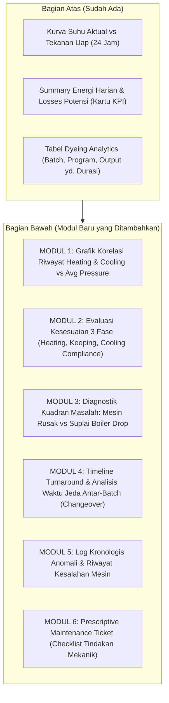

# Blueprint Desain & Spesifikasi Analitik Mendalam (Depth Analytics)
## Laman Analitik Harian Mesin (`8002/machine-daily-analytics`)
### Mentransformasikan Dashboard Mesin Menjadi *Engineering Diagnostic Dossier & Audit Report*

---

## 1. Pendahuluan & Filosofi: Menyamai Kedalaman `/history/report/`

Laporan per-batch di `8002/history/report/` telah diakui memiliki kedalaman analitik yang kuat karena menyajikan:
1. **Dekomposisi Fase Fisik**: Durasi pemanasan (*heating*), penahanan suhu (*keeping/holding*), dan pendinginan (*cooling*).
2. **Konteks Boiler Real-Time**: Tekanan uap aktual vs ambang batas kritis (3.8 bar).
3. **Forensik Operator**: Kedisiplinan penanganan suhu dan keterlambatan eksekusi.
4. **Kuantifikasi Kerugian Finansial**: Lapis 1 vs Lapis 2 vs Lapis 3 (PINN) dalam Rupiah.

Namun, di laman **`8002/machine-daily-analytics`**, data saat ini **berhenti begitu tabel *Dyeing Analytics* selesai**. Tidak ada jembatan yang menghubungkan performa batch hari ini dengan riwayat batch-batch sebelumnya, dan tidak ada evaluasi apakah performa mesin sedang mengalami degradasi mekanik atau murni terkendala pasokan uap pabrik.

Dokumen ini merancang modul analitik lanjutan yang ditempatkan **di bawah tabel Dyeing Analytics** dengan standar audit profesional, transparan, dan dapat dipertanggungjawabkan secara teknis.

---

## 2. Arsitektur Struktur Laman Lengkap (`machine-daily-analytics`)



---

## 3. Rincian Modul Utama 1: Grafik Korelasi Riwayat Heating & Cooling vs Avg Pressure

### 3.1. Konsep & Tujuan
Grafik ini memetakan **seluruh batch riwayat mesin tersebut (misal 30–60 hari terakhir)** untuk program yang dipilih, sehingga kepala mekanik dan manajemen dapat melihat tren stabilitas laju pemanasan dan pendinginan terhadap fluktuasi tekanan uap dari boiler.

### 3.2. Spesifikasi Visual Grafik (Interactive Dual-Axis Scatter & Trend Line)
* **Sumbu X**: Tekanan Uap Rata-rata (`avg_steam_pressure` dalam **bar**, skala 2.0 s/d 6.0 bar).
  * Dilengkapi garis vertikal putus-putus merah di **3.8 bar** (*Critical Steam Pressure Threshold*).
* **Sumbu Y (Kiri)**: Durasi Pemanasan Aktual (`real_heating_duration` dalam **menit**).
* **Sumbu Y (Kanan)**: Durasi Pendinginan Aktual (`cooling_duration` dalam **menit**).
* **Filter Program**: Dropdown pemilih program (*P. 015, P. 005, P. 008, P. 009, atau Tampilkan Semua*).
* **Marker / Titik Data**:
  * Titik Biru = Batch-batch riwayat sebelumnya.
  * Titik Bintang Emas (*Highlighted*) = Batch yang dikerjakan **hari ini**.
  * Garis Referensi Horizontal Hijau = Durasi Ideal Heating Program ($T_{\text{heat, ideal}}$).
  * Garis Referensi Horizontal Biru = Durasi Ideal Cooling Program ($T_{\text{cool, ideal}}$).

### 3.3. Matriks 4 Kuadran Diagnostik (Root-Cause Matrix)
Dengan memplot durasi pemanasan terhadap tekanan uap, sistem secara otomatis mengelompokkan setiap batch ke dalam salah satu kuadran:

```
                  Durasi Heating (Menit)
                           ▲
                           │
      KUADRAN III:         │        KUADRAN II:
   DEGRADASI MEKANIK       │    SUPPLY DEFICIT BOILER
  (Tekanan Cukup >3.8 bar, │  (Tekanan Rendah <3.8 bar,
   tapi Heating Molor)     │   Heating Wajar Molor)
   -> Indikasi Kerak HE /  │   -> Gangguan Pembakaran
      Bypass Valve Macet   │      di Ruang Boiler
                           │
  ─────────────────────────┼─────────────────────────► Avg Pressure
                           │                           (bar)
                           │   Ambang Kritis (3.8 bar)
      KUADRAN I:           │        KUADRAN IV:
    ZONA OPTIMAL /         │     ANOMALI / LOW LOAD
    PERFORMA PRIMA         │  (Tekanan Rendah tapi Cepat)
  (Tekanan Cukup &         │   -> Volume Air Sedikit /
   Durasi Sesuai Standar)  │      Kain Ringan
                           │
```

* **Manfaat Audit**: Manajemen tidak bisa lagi diperdaya oleh alasan klise *"uapnya drop"*. Jika titik batch berada di **Kuadran III**, maka bukti sensor menunjukkan tekanan uap boiler saat itu tinggi (misal 5.1 bar), sehingga akar masalahnya murni **kerusakan atau kerak pada mesin jet itu sendiri**.

---

## 4. Rincian Modul Utama 2: Evaluasi Kesesuaian 3 Fase (Compliance Engine)

Sistem mengevaluasi setiap fase proses celup pada hari ini dan membandingkannya dengan standar ideal program serta rata-rata historis mesin tersebut:

### 4.1. Evaluasi Fase Heating (Kenaikan Suhu)
1. **Laju Pemanasan Aktual ($\text{Ramp Rate}$)**:
   $$\text{Ramp Rate}_{\text{aktual}} = \frac{T_{\text{peak}} - T_{\text{start}}}{\text{Durasi Heating (menit)}} \quad (^\circ\text{C/menit})$$
   * Standar Program: $2.5\ ^\circ\text{C/menit}$ s.d. $3.0\ ^\circ\text{C/menit}$.
2. **Kriteria Kepatuhan**:
   * **SESUAI (Compliant)**: Deviasi durasi $\le +10$ menit dari standar program.
   * **TERLAMBAT AKIBAT BOILER**: Molor $> 10$ menit KETIKA rata-rata tekanan uap $< 3.8\text{ bar}$.
   * **TERLAMBAT AKIBAT MESIN (HE SCALING)**: Molor $> 15$ menit KETIKA tekanan uap $\ge 4.0\text{ bar}$. Sistem menandai penurunan koefisien transfer panas ($U \cdot A$).

### 4.2. Evaluasi Fase Keeping / Holding (Penahanan Suhu Puncak)
1. **Stabilitas Suhu ($\Delta T_{\text{hold}}$)**:
   * Mengukur deviasi standar suhu selama fase holding pada suhu target (misal $130^\circ\text{C}$).
2. **Kriteria Kepatuhan**:
   * **STABIL**: Fluktuasi suhu $\le \pm 1.0^\circ\text{C}$.
   * **TEMPERATURE DIP (BAHAYA KAIN BELANG)**: Suhu drop $> 2.5^\circ\text{C}$ di tengah holding $\rightarrow$ memicu peringatan resiko cacat warna (*unlevel dyeing*).
   * **VALVE WEEPING / LEAK**: Suhu terus naik melebihi target (misal $130^\circ\text{C} \rightarrow 134^\circ\text{C}$) $\rightarrow$ indikasi katup pneumatik uap tidak menutup rapat.
   * **OVER-HOLDING (DISIPLIN OPERATOR)**: Waktu holding molor $> 15$ menit dari target program $\rightarrow$ indikasi kelalaian operator terlambat mengambil contoh lab (*sampling swatch*) atau lambat memasukkan obat penutup.

### 4.3. Evaluasi Fase Cooling (Pendinginan)
1. **Laju Pendinginan Aktual ($\text{Cooling Rate}$)**:
   $$\text{Cooling Rate}_{\text{aktual}} = \frac{T_{\text{hold}} - T_{\text{end}}}{\text{Durasi Cooling (menit)}} \quad (^\circ\text{C/menit})$$
   * Standar Program: $1.8\ ^\circ\text{C/menit}$ s.d. $2.2\ ^\circ\text{C/menit}$.
2. **Kriteria Kepatuhan**:
   * **SESUAI**: Durasi pendinginan $\le \text{Durasi Cooling Ideal} + 5$ menit.
   * **PENDINGINAN LAMBAT (COOLING DEFICIT)**: Durasi pendinginan $> 2\times$ lipat dari standar (misal program 20 menit, aktual 55 menit).
   * **Akar Masalah**: Pipa penukar panas sisi air kotor, filter air sirkulasi mampet, atau pasokan air *cooling tower* bersuhu terlalu hangat.

---

## 5. Fitur-Fitur Bernilai Tambah Lainnya (Ide Pendukung Berbobot)

Selain grafik riwayat durasi dan evaluasi kesesuaian 3 fase, berikut adalah 4 fitur tambahan yang sangat penting agar laporan menjadi berstandar kelas industri (*world-class*):

### 5.1. Peta Waktu Menganggur & Turnaround 24 Jam (Changeover Gantt)
* **Masalah**: Seringkali kapasitas mesin terbuang bukan saat kain diproses, melainkan di **jeda waktu antar-batch**.
* **Penyajian**: Timeline horizontal 24 jam yang merinci:
  * Jam kerja efektif proses celup ($X$ jam).
  * Waktu bongkar & muat kain (*Changeover* ideal $\le 30$ menit).
  * Waktu menganggur tanpa alasan jelas (*Unexplained Idle Time*).
  * Waktu cuci mesin (*Machine Washing*).
* **Kalkulasi Biaya Idle**: Mengonversi jam nganggur menjadi kerugian biaya tetap pabrik (*Fixed Overhead Cost*).

### 5.2. Thermal Degradation Index (Trend Penurunan Heat Exchanger 30 Hari)
* **Konsep**: Memantau laju penurunan efisiensi penukar panas mesin dari waktu ke waktu.
* **Metode**: Menggunakan model fisika PINN untuk mengekstraksi koefisien transfer panas efektif $U_{\text{eff}}(t)$:
  $$U_{\text{eff}} = \frac{M_{\text{eq}} \cdot C_p \cdot \frac{dT}{dt}}{A \cdot (T_{\text{steam}} - T_{\text{kain}})}$$
* **Output**: Garis tren 30 hari. Jika $U_{\text{eff}}$ turun $> 20\%$ dibanding kondisi bersih, sistem mengeluarkan rekomendasi: **"Jadwalkan Descaling Kimia pada Heat Exchanger Mesin Ini"**.

### 5.3. Sensor Integrity & Data Reliability Score
* **Masalah**: Laporan tidak akan dipercaya jika sensor suhu PT100 sering loncat atau rusak.
* **Analisis**:
  * Menghitung persentase log menit yang valid ($T > 20^\circ\text{C}$ dan $T < 145^\circ\text{C}$).
  * Mendeteksi *Noise Spike* (suhu berubah $> 15^\circ\text{C}$ dalam 60 detik tanpa dasar fisik).
  * Memberikan skor: **Sensor Integrity: 99.8% (Valid & Terpercaya)**.

### 5.4. Prescriptive Maintenance Action Ticket (Perintah Kerja Mekanik Otomatis)
* Di bagian paling bawah laporan, sistem merangkum seluruh temuan menjadi **Checklist Perintah Kerja Mekanik (Work Order)**:
  1. Status Katup Utama Uap (*Steam Control Valve*).
  2. Status Perangkap Uap (*Steam Trap Condensate*).
  3. Status Filter & Sirkulasi Air Pendingin (*Cooling Valve & Strainer*).
  4. Status Probe Sensor Suhu (*Thermocouple / PT100 Calibration*).

---

## 6. Desain Layout & Wireframe UI Profesional (A4 Ready)

Tampilan baru di bawah tabel *Dyeing Analytics* dirancang dengan grid rapi, padat informasi, dan siap cetak (*Print-Ready*):

```
+---------------------------------------------------------------------------------------------------+
| [TABEL DYEING ANALYTICS SAAT INI]                                                                |
+---------------------------------------------------------------------------------------------------+
|                                                                                                   |
| SECTION A: GRAFIK KORELASI RIWAYAT HEATING & COOLING VS AVG STEAM PRESSURE                        |
| +-----------------------------------------------------------------+ +---------------------------+ |
| | Scatter / Bubble Chart (Riwayat 30 Batch Terakhir Mesin Ini):   | | Filter Program:           | |
| |                                                                 | | [ P. 015 - Dark 130°C  v] | |
| |  Durasi (mnt)                                                   | |                           | |
| |   300│            ★ Batch #250 (Kerak HE)                       | | Ringkasan Evaluasi:       | |
| |   250│                                                          | | Total Batch Riwayat: 42   | |
| |   200│       ●         ●                                        | | Rata-rata Heating: 148m   | |
| |   150│───────────────★ Batch #253───────── GRS IDEAL HEAT (125m)| | Target Ideal: 125m        | |
| |   100│                                                          | | Deviasi Rata-rata: +23m   | |
| |    50│──●────●───────★ Batch #249───────── GRS IDEAL COOL (20m) | | Rata-rata Cooling: 42m    | |
| |     0└───────────────┬───────────────────                       | | Target Ideal: 20m         | |
| |     2.0             3.8 (Kritis)       6.0  Avg Pressure (bar)  | | Deviasi Cooling: +22m     | |
| |  [● Batch Riwayat Lalu]  [★ Batch Hari Ini]  [── Ambang Kritis] | | Indikasi: Kerak HE Ringan | |
| +-----------------------------------------------------------------+ +---------------------------+ |
|                                                                                                   |
| SECTION B: EVALUASI KESESUAIAN 3 FASE (COMPLIANCE AUDIT BATCH HARI INI)                           |
| +-----------------------------+ +-----------------------------+ +-------------------------------+ |
| | FASE HEATING (PEMANASAN)    | | FASE KEEPING (HOLDING)      | | FASE COOLING (PENDINGINAN)    | |
| | Status: ⚠️ TERTUNDA (+22m)  | | Status: ✅ SESUAI & STABIL  | | Status: 🚨 DEGRADASI (+32m)   | |
| | Laju: 1.8 °C/m (Idl: 2.7)   | | Fluktuasi: ± 0.6 °C (Aman)  | | Laju: 0.9 °C/m (Idl: 2.0)     | |
| | Suplai Uap: 4.5 bar (Bagus) | | Suhu Puncak: 130.4 °C       | | Suplai Air: Terhambat         | |
| | Diagnosa: Kerak HE Internal | | Over-holding: Tidak Ada     | | Diagnosa: Cek Strainer Filter | |
| +-----------------------------+ +-----------------------------+ +-------------------------------+ |
|                                                                                                   |
| SECTION C: PETA WAKTU OPERASI 24 JAM & TURNAROUND (CHANGEOVER GAP ANALYSIS)                       |
| +-----------------------------------------------------------------------------------------------+ |
| | 06:00          10:00          14:00          18:00          22:00          02:00        06:00 | |
| | [Batch #250]═════[28m]═══[Batch #251]═══════════[65m IDLE]═════[Batch #252]══════[50m IDLE]══ | |
| | Total Jam Operasi Efektif : 16.2 Jam (67.5% Uptime)                                           | |
| | Total Waktu Changeover     : 3.8 Jam (Rata-rata 42 menit/batch - Toleransi 30m)               | |
| | Waktu Menganggur Terbuang : 4.0 Jam (Estimasi Kerugian Overhead: Rp 260.000,-)                | |
| +-----------------------------------------------------------------------------------------------+ |
|                                                                                                   |
| SECTION D: LOG ANOMALI & PRESCRIPTIVE MAINTENANCE TICKET (UNTUK TEKNISI MEKANIK)                  |
| +-----------------------------------------------------------------------------------------------+ |
| | 📋 CHECKLIST PERINTAH KERJA MEKANIK (PREVENTIVE MAINTENANCE):                                 | |
| | [ ] 1. Lakukan pembersihan strainer pipa pendingin (Fase cooling molor +32 menit).            | |
| | [ ] 2. Jadwalkan descaling kimia pada penukar panas (Laju pemanasan turun dari 2.7 ke 1.8 °C).| |
| | [ ] 3. Verifikasi katup uap pneumatik (Suhu holding stabil, tidak terdeteksi kebocoran valve).| |
| | [x] 4. Sensor suhu PT100 terverifikasi akurat (Integritas sensor 100%, 0 spike).             | |
| +-----------------------------------------------------------------------------------------------+ |
+---------------------------------------------------------------------------------------------------+
```

---

## 7. Formulasi Backend & Kebutuhan Endpoint API

Untuk menyajikan data ini secara instan tanpa membebani server, backend `monitoring/api_report.py` pada fungsi `get_report_machine_daily_chart` akan diperkaya dengan kalkulasi berikut:

1. **Query Riwayat Batch Mesin (`history_phase_scatter`)**:
   ```python
   # Mengambil 40 batch terakhir dari mesin yang sama
   historical_batches = DyeingProcess.objects.filter(
       machine=machine,
       is_valid_process=True,
       duration_effective__isnull=False
   ).select_related('identity__program').order_by('-start_time')[:40]
   ```
2. **Kalkulasi Laju Pemanasan & Pendinginan**:
   ```python
   ramp_up_rate = (b.max_temp - start_temp) / b.real_heating_duration if b.real_heating_duration > 0 else 0
   cooling_rate = (b.max_temp - end_temp) / b.cooling_duration if b.cooling_duration > 0 else 0
   ```
3. **Deteksi Kuadran Masalah**:
   ```python
   if b.real_heating_duration > prog.durasi_heating_ideal + 15:
       if b.avg_steam_pressure and b.avg_steam_pressure >= 4.0:
           diagnosis = "HE_SCALING_OR_MECHANICAL"
       else:
           diagnosis = "BOILER_PRESSURE_DROP"
   else:
       diagnosis = "COMPLIANT"
   ```

---

## 8. Dampak Nyata bagi Manajemen & Teknisi Pabrik

1. **Transparansi Sengketa Boiler vs Mesin**: Mengakhiri perdebatan harian antara operator celup dan petugas boiler karena kuadran grafik membuktikan secara objektif kapan mesin yang bermasalah dan kapan tekanan boiler yang drop.
2. **Pencegahan Cacat Celup (*Zero Defect*)**: Evaluasi fase holding yang ketat mendeteksi *temperature dip* dan *valve weeping* sebelum kain keluar dalam kondisi belang atau rusak.
3. **Peningkatan Kapasitas Melalui Penurunan Changeover**: Peta jeda 24 jam memperlihatkan menit-menit di mana mesin menganggur tanpa kain, memberi target konkret bagi supervisor untuk menekan waktu bongkar/muat kain menjadi rata-rata 25 menit.
4. **Perawatan Berbasis Kondisi (*Condition-Based Maintenance*)**: Mekanik tidak lagi melakukan servis mesin berdasarkan tebakan atau jadwal buta, melainkan langsung menuju komponen yang terindikasi menurun performanya (*targeted maintenance*).
